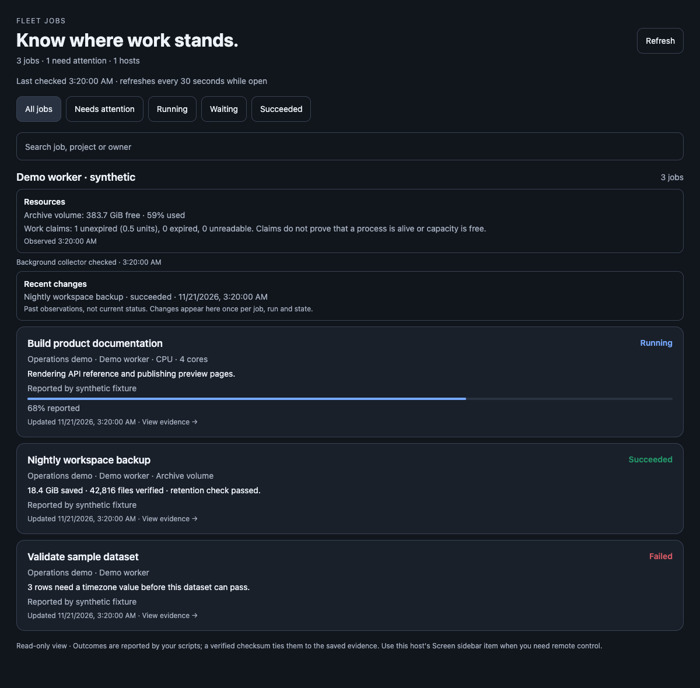
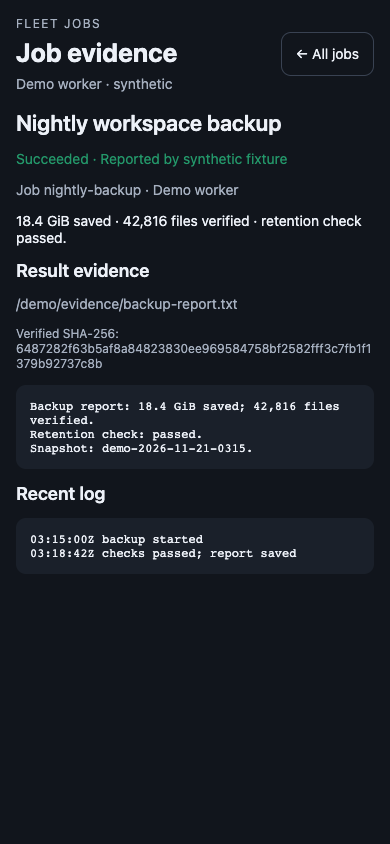

# Fleet Jobs for Paseo

**Check on long-running work without opening another terminal.**

Fleet Jobs brings job progress, results and saved evidence into Paseo. See what is running, what needs attention and what finished—on one machine or across your own SSH-connected workers. Open a job to read its result report and recent log from your desktop or phone.

Your scripts publish small JSON receipts, or an optional file observer watches a result file you choose. Fleet Jobs displays those records; your existing tools keep running the work.



*The screenshots use entirely fictional jobs, hosts, paths and reports. They render the real plugin interface in a browser; the narrow screenshot below is a mobile-sized preview, not a native phone capture.*

## Where it helps

| When you… | Fleet Jobs helps you… |
| --- | --- |
| Leave a build or test suite running | Check its reported progress and open the saved test report when it finishes. |
| Run backups or data exports overnight | See the reported outcome and inspect a verification report without finding the right terminal. |
| Process video, audio or a large dataset | Follow script-reported progress and spot a stale heartbeat. |
| Run model evaluations or experiments | Keep the reported verdict next to the exact saved evidence; leave results unknown when no verdict exists. |
| Use several machines | View local jobs and up to eight explicitly configured SSH sources together, with optional disk and NVIDIA GPU readings. |

### From status to evidence

A green result means the publisher reported success **and** the saved evidence matches its recorded SHA-256. If that evidence disappears or changes, the result becomes unknown. The checksum checks the saved bytes; your script or observer rule decides what counts as success.



### Fits around your existing workflow

- **Start small:** one Paseo host and one receipt; remote aggregation is optional.
- **Keep your runners:** add receipt commands to a shell script, scheduled task or agent workflow, or configure a file observer without changing the runner.
- **Catch up later:** the background collector retains a local Recent changes inbox while the host is awake and Paseo is running.
- **Keep data on your hosts:** receipts and settings live outside the plugin; remote sources use your existing SSH access. Paired Paseo clients can read the configured metadata and evidence.

Fleet Jobs is a read-only view of jobs. It does not launch or stop work, automatically discover processes, reserve resources or send phone push notifications.

[Install](#install-from-a-git-checkout) · [Try a demo](#try-it-with-a-fictional-job) · [Connect workers](#optional-ssh-sources) · [Observe existing reports](#automatic-file-observers) · [Data and trust](#data-and-trust)

## Requirements

- Paseo 0.12.0 or later
- Node.js 20 or later on each host running the `fleet-jobs` CLI
- For optional remote hosts: SSH available on the Paseo server host, key-based access, and the remote host key already trusted in `known_hosts`

The UI uses the client supplied by Paseo and is available in Paseo desktop and mobile clients when plugins are enabled on the host. macOS and Linux have been exercised; Windows has not been validated.

## Install from a Git checkout

Keep the checkout in a persistent directory and install its absolute path:

```sh
paseo plugin install /absolute/path/paseo-fleet-jobs
node /absolute/path/paseo-fleet-jobs/bin/fleet-jobs.mjs --help
```

The CLI is already bundled. No dependency installation or build is needed to run it. Enable plugins in Paseo settings if needed.

## Install from a package tarball

If you already have a release tarball, skip to extraction below. To create one from this repository:

```sh
npm ci
npm pack
```

Extract it and install the extracted package directory. Replace the example path with the absolute path on your machine:

```sh
mkdir -p "$HOME/fleet-jobs-package"
tar -xzf paseo-fleet-jobs-0.2.1.tgz -C "$HOME/fleet-jobs-package"
paseo plugin install "$HOME/fleet-jobs-package/package"
```

Enable plugins in Paseo Settings → Plugins if the host has them disabled. This is a host-wide setting; Fleet Jobs does not change it. Keep the extracted directory in place while it is installed.

Repeat the installation on each Paseo host where you want Fleet Jobs available. To use the commands below, invoke `node "$HOME/fleet-jobs-package/package/bin/fleet-jobs.mjs"` in place of `fleet-jobs`, or add an equivalent wrapper to your PATH.

The package and Git source contain the bundled `fleet-jobs` CLI as well as the plug-in. A Git installation needs no dependency installation to run this CLI. To rebuild it during development, use `npm ci` followed by `npm run build:cli`; commit the regenerated bundle with its source changes.

## Try it with a fictional job

Run this on the **Paseo host** where you installed the plugin. Set the first path to your checkout or extracted package. The helper calls the bundled CLI directly; no global npm install is needed.

```sh
FLEET_JOBS_PLUGIN="/absolute/path/paseo-fleet-jobs"
fleet_jobs() { node "$FLEET_JOBS_PLUGIN/bin/fleet-jobs.mjs" "$@"; }

# A separate directory and a unique id keep every demo run distinct.
demo_run="demo-$(date +%Y%m%d-%H%M%S)-$$"
mkdir -p "$HOME/fleet-jobs-demo/$demo_run"
cd "$HOME/fleet-jobs-demo/$demo_run"
now=$(date -u +%Y-%m-%dT%H:%M:%SZ)
cat > receipt.json <<EOF
{
  "schemaVersion": 1,
  "id": "$demo_run",
  "title": "Build the example docs",
  "project": "Getting started",
  "status": "running",
  "startedAt": "$now",
  "updatedAt": "$now",
  "message": "Fictional demo; no build was launched"
}
EOF
fleet_jobs record ./receipt.json
fleet_jobs heartbeat "$demo_run" --progress 60 --message "Demo: checking links"
```

Open **Fleet Jobs** from the host's Paseo sidebar and refresh. You should see the demo at 60% reported progress. Then, in the same shell, write its fictional result and mark it complete:

```sh
printf '%s\n' 'Demo report: 24 example pages checked; 0 broken links.' > result.txt
fleet_jobs finish "$demo_run" --status succeeded --evidence ./result.txt \
  --message "Demo complete; open the saved report"
fleet_jobs detail "$demo_run"
```

Refresh and open the job: its state should be **Succeeded**, with the report and a verified checksum. Keep `result.txt` in place if you want that evidence to remain readable. This example uses the default data home; if your installation uses a custom home, pass the same `--home PATH` to the CLI. A CLI-only `FLEET_JOBS_HOME` environment change does not reconfigure an already-running Paseo daemon.

The remaining examples use `fleet-jobs` as shorthand for the bundled CLI. You can use the `fleet_jobs` helper above instead.

## Publish and inspect receipts

Job scripts own receipt creation and updates. By default, the CLI stores receipts under `~/.paseo-fleet-jobs/jobs/`; set `FLEET_JOBS_HOME` or pass `--home PATH` to choose another data directory. This data directory is outside the installed package and should be retained when updating the plug-in.

For a real job, choose an id unique to that run and use current timestamps. Create a receipt JSON file and an evidence artifact. The receipt input must be a regular file no larger than 32 KiB. Evidence and optional log paths may be relative to the receipt file. `record` validates the complete receipt, resolves paths, hashes current evidence, and writes the receipt atomically:

```sh
fleet-jobs record ./run-receipt.json
```

Example input (`run-receipt.json`):

```json
{
  "schemaVersion": 1,
  "id": "build-2026-11-20-a1",
  "title": "Example build",
  "status": "running",
  "startedAt": "2026-11-20T12:00:00.000Z",
  "updatedAt": "2026-11-20T12:00:00.000Z",
  "staleAfterSeconds": 900,
  "evidence": { "path": "./result.txt" }
}
```

The CLI calculates the SHA-256 digest for the evidence file; a digest in the input is unnecessary. Evidence must be valid UTF-8 text in a regular, non-symlink file no larger than 2 MiB. Keep the id unique to a run. An existing nonterminal receipt can only be replaced with `--replace`; terminal receipts cannot be overwritten.

Send periodic heartbeats while a job is active:

```sh
fleet-jobs heartbeat build-2026-11-20-a1 --message "Compiling" --progress 45 --status running
fleet-jobs heartbeat build-2026-11-20-a1 --message "Waiting for review" --status waiting
```

Finish a run only after its artifact has been written:

```sh
fleet-jobs finish build-2026-11-20-a1 --status succeeded --evidence ./result.txt --message "Build complete"
```

`finish` accepts `succeeded` or `failed`, requires an evidence path, and hashes the file again. A succeeded state means the publisher reported success and the saved artifact matches its recorded checksum. The checksum does not establish that the artifact proves a correct result or that the publisher is truthful. A missing, unreadable, or changed artifact makes a reported success show as unknown.

List the CLI data location or read machine-readable output:

```sh
fleet-jobs where
fleet-jobs snapshot
fleet-jobs detail build-2026-11-20-a1
```

All commands support `--home PATH`; the environment variable `FLEET_JOBS_HOME` sets the same home directory. For example:

```sh
fleet-jobs --home "$HOME/job-data" heartbeat build-2026-11-20-a1 --progress 72
```

### Receipt states

Receipt status is supplied by the publishing script: `running`, `waiting`, `succeeded`, `failed`, or `unknown`. Active receipts become `stale` in the viewer when `updatedAt` is older than `staleAfterSeconds` (900 seconds by default). Stale is a viewer assessment of heartbeat age; it does not stop a job. Terminal states cannot be changed by heartbeat or finish. Use a new id for each rerun.

## Optional SSH sources

To show other hosts in the same fleet view, create `sources.json` in the Fleet Jobs data home (next to the `jobs` directory). It must be a JSON array with at most eight entries. Each entry needs a unique id other than `local`, a label, an SSH destination, and an absolute path to the remote bundled CLI:

```json
[
  {
    "id": "worker-a",
    "label": "Worker A",
    "sshHost": "user@worker-a.example.net",
    "cliPath": "/opt/fleet-jobs/bin/fleet-jobs.mjs",
    "nodePath": "/usr/local/bin/node",
    "dataHome": "/var/lib/fleet-jobs",
    "serverId": "worker-a-server"
  }
]
```

`knownHostsFile`, `nodePath`, `dataHome`, and `serverId` are optional. `knownHostsFile` selects an absolute local SSH host-key database path when your keys are not in the default file. `nodePath` selects the remote Node executable; it defaults to `node`. To find its absolute path on the remote host, run `command -v node` there. `dataHome` selects the remote CLI's data home. `serverId` lets Paseo link a listed agent to its owning server when supported. The CLI must be installed at `cliPath`, and the SSH account must be able to read the configured data home and artifacts.

The Paseo host invokes only the fixed `snapshot` and `detail` CLI commands over noninteractive SSH. It uses strict host-key checking, batch authentication, and bounded timeouts and output. It does not send job commands. Fleet Jobs validates returned data against its schemas. Configure trusted SSH access and understand that remote receipt metadata, previews, and evidence content are shared with the paired Paseo clients and host.

## Data and trust

Receipts are files created by the job's own script; Fleet Jobs does not scan arbitrary folders or replace a task database. The CLI accepts strict schema fields and safe ids. Logs and evidence are read with size limits. Local receipt files live under the data home, while evidence and logs remain at the paths published in each receipt.

The status is a publisher claim. SHA-256 detects whether the evidence bytes changed since publication; it is not a semantic evaluation, signature, or independent audit. Treat receipt publishers, SSH sources, and their evidence as trusted inputs.

## Automatic file observers

Place an array in `<data home>/observers.json`; see [the observer example](examples/observer.json). Each entry names an explicit evidence path, a unique run id, `runStartedAt`, and an outcome rule. Text rules use distinct literal success/failure markers; JSON rules compare one explicit field path with scalar success/failure values. Use `{ "kind": "unassessed" }` when the artifact contains metrics without an acceptance verdict: its status stays unknown. Configuration is bounded to 32 entries and 32 KiB.

An optional `heartbeatPath` uses that file's modification time, so an unchanged file never receives a fresh heartbeat merely because the observer is polling. A PID file is unsuitable. `logPath` supplies a diagnostic tail. Evidence must be a real UTF-8 file of at most 2 MiB and must not predate the run. Both outcome markers in one artifact are ambiguous and remain unknown. A configured rule is a publisher policy, not independent semantic validation.

The observer owns only receipts it created. It refuses existing manual receipts or changed configuration under the same id. Give each rerun or changed rule a new id. Accepted terminal receipts keep the original evidence checksum; subsequently changed evidence cannot be silently reaccepted. Existing job scripts need no modification.

The installed plugin collects on its host at startup and every minute, even with no client open. For an immediate collection:

```sh
fleet-jobs collect
```

The daemon must remain running and the host awake. Each worker collects independently; a coordinator's sleep does not suspend the other workers. The CLI's `snapshot` and `detail` remain read-only.

## Resource observations

Optional `<data home>/resources.json` configures up to eight explicit disk paths, NVIDIA telemetry, and a local directory of heavy-work claims; see [the resource example](examples/resources.json). Disk readings show available space. NVIDIA uses only `/usr/bin/nvidia-smi` with a fixed bounded query. Unsupported hardware produces an unavailable reading. Resource readings cache for at most one minute in the daemon.

Work claims show only aggregate counts and weights from bounded claim files. “Unexpired” describes their timestamp/TTL window, not process liveness or free capacity. GPU utilization is also not reservation availability. Fleet Jobs never acquires leases, prunes claims, or reserves resources.

## Persistent change inbox

The first collection establishes a quiet baseline. Subsequent transitions to waiting, succeeded, failed, stale or unknown appear under **Recent changes**. A job/run/state is reported once, including after plugin reload. The most recent 100 changes are retained in `monitor.json`; up to 400 recent run identities retain deduplication history. The UI shows the newest five per host; `fleet-jobs snapshot` includes the entire retained inbox. These are historical observations, not current job status.

This inbox does not send operating-system or phone push notifications. It needs no push tokens or external notification service. A stale collector timestamp or invalid configuration is visible in the host panel. Collection does not replace malformed monitor state. If a collector crashed while holding `monitor.lock` or a receipt lock, inspect its owner/process before moving the stale lock aside; a live lock must not be removed.

## Updating and removing

Keep the data home when replacing the extracted package in its existing location, then run `paseo plugin reload paseo-fleet-jobs`. Do not install the same plugin twice. Remove it through Paseo's plugin controls when no longer needed; cleanup stops its polling timer. Existing receipts, evidence and logs remain yours.

## Development and license

The source includes the plugin, bundled CLI, typed receipt schemas and tests. For development:

```sh
npm ci
npm run typecheck
npm test
npm run build:cli
```

Commit the regenerated CLI with any CLI source changes. Screenshot provenance is documented in [assets/README.md](assets/README.md).

[MIT](LICENSE). Bundled dependency attribution is in [THIRD_PARTY_NOTICES.txt](THIRD_PARTY_NOTICES.txt).
